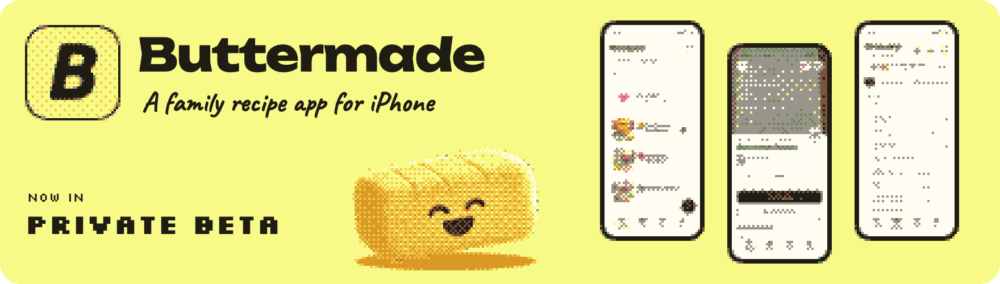

### Hi, I'm Ben.

I build native Android and iOS apps, and I care as much about how they look and feel as how they work. Demos and screenshots of everything below are at [benfallon.tech](https://benfallon.tech).

#### Now building

**[Buttermade](https://buttermade.buttr.studio)** is a cookbook a family shares on iPhone. Each recipe keeps a photo of the original card, and anyone in the family can cook from it, save their own version and see what everyone else has been making. It is in private beta on TestFlight.

#### Other apps

- **[Pushups for iOS](https://apps.apple.com/us/app/pushups-track-your-progress/id6742363164)** is a pushup tracker where logging a set takes one tap. It has charts, daily goals and streaks, and needs no account. On the App Store.
- **Pushups for Android** is the same tracker, built again in Kotlin and Jetpack Compose.
- **[Design Eat Repeat](https://www.designeatrepeat.com)** is a native iOS app for my sister Melissa's food blog and its 15 years of recipes.
- **Midstate Vet** is an iOS and Android app that a veterinary clinic uses for billing and time tracking during farm calls.

I'm glad to hear about senior Android and mobile engineering roles. [LinkedIn](https://www.linkedin.com/in/benfallon) is the best way to reach me.
